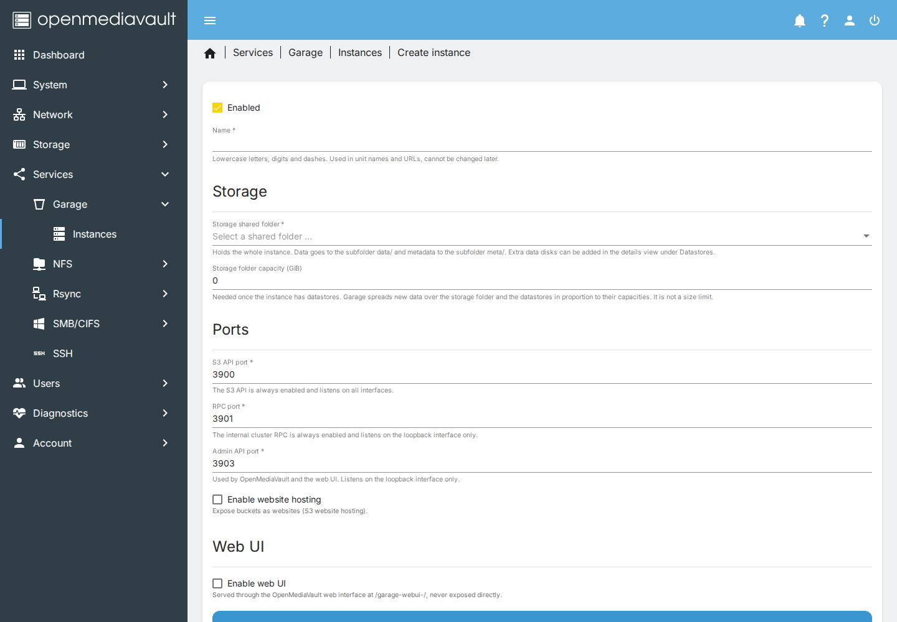
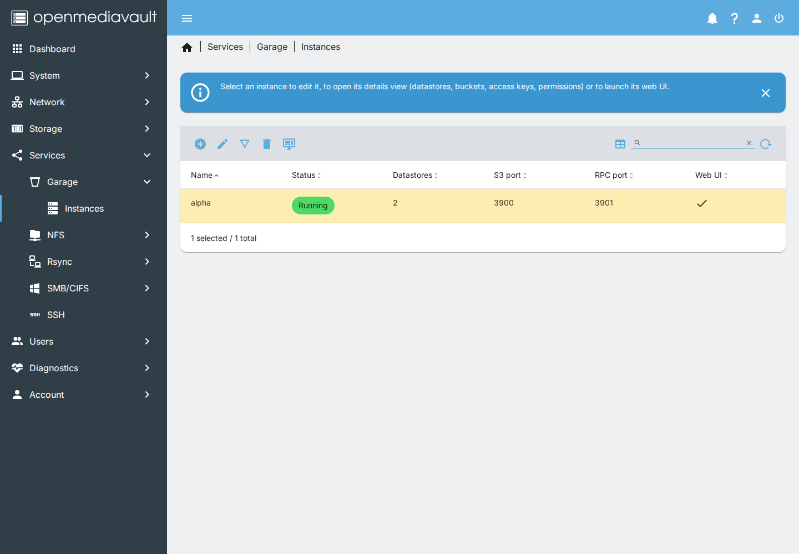
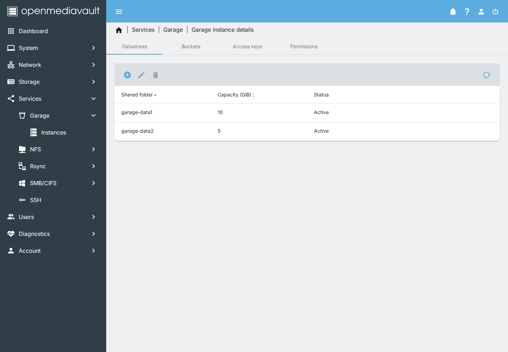
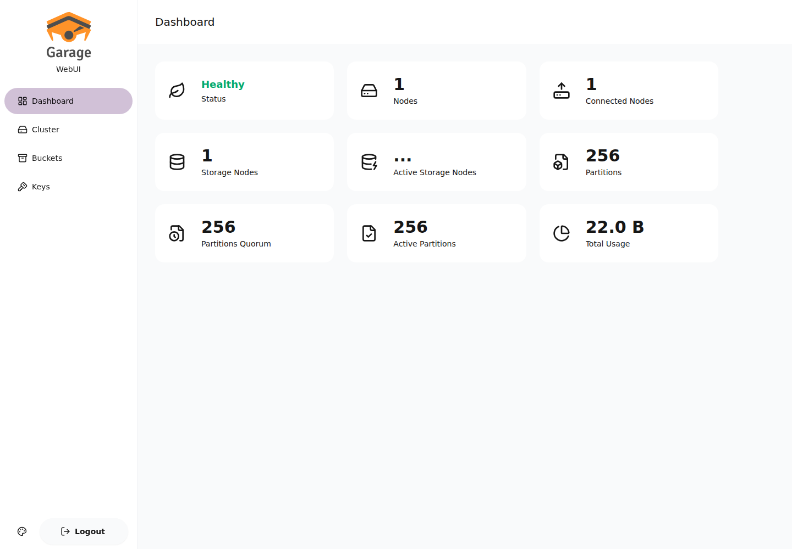

# openmediavault-garage

An OpenMediaVault 8 plugin for [Garage](https://garagehq.deuxfleurs.fr), the
S3-compatible object storage from Deuxfleurs.

It adds a **Services > Garage** page where you create and manage Garage
instances without containers. Each instance is a normal systemd service,
`garage@<name>`, running as a dedicated `garage` user.

It is a spiritual successor to the removed MinIO-based
[openmediavault-s3](https://github.com/openmediavault/openmediavault/commit/f4375a4491c1b9410c6e0a63eac503315be78a3c)
plugin.

## What you get

- several Garage instances on one OMV box
- each instance with one or more datastores on OMV shared folders
- buckets with quotas and optional website hosting
- access keys you create or import
- per key and bucket read, write, and owner permissions
- an optional community web UI, opened from the OMV login
- an optional public endpoint for generated object URLs
- automatic free port detection, systemd hardening, and cleanup when you
  delete an instance

## Requirements

- OpenMediaVault 8 Synchrony on Debian 13
- the `garage` package, version 2.5.0 or later, from the
  [garage-debian](https://github.com/zumoshi/garage-debian) repo
- amd64

The plugin is not in omv-extras yet. Install the debs from the GitHub
releases.

## Install

On the OMV box, download the latest debs and install them. The garage package
comes from the [garage-debian](https://github.com/zumoshi/garage-debian) repo.

```sh
wget -qO- https://api.github.com/repos/zumoshi/garage-debian/releases/latest \
  | grep -o 'https://[^"]*amd64.deb' | head -1 | xargs wget
wget -qO- https://api.github.com/repos/zumoshi/openmediavault-garage/releases/latest \
  | grep -o 'https://[^"]*amd64.deb' | head -1 | xargs wget
sudo apt install ./garage_*_amd64.deb
sudo apt install ./openmediavault-garage_*_amd64.deb
```

Then open **Services > Garage**.

## Quick start

1. **Services > Garage > Instances > Create**.
2. Give it a name, pick a storage shared folder, and keep the suggested ports.
   The storage folder holds the whole instance.
3. Save, then click the checkmark in the pending-changes bar to apply. OMV
   writes `/etc/garage/<name>.toml`, sets the ACLs, starts `garage@<name>`,
   and creates the single-node layout.
4. Open the instance's **Show details** page and create a bucket and an access
   key. Grant the key read, write, or owner on the bucket.
5. Point your S3 client at `http://<omv>:<s3-port>`, with the region from the
   instance settings and the key you created.



That is enough for a working S3 endpoint. The web UI is optional and off by
default.

## Using it

The screenshots use an example instance named alpha.

### Instances

Each instance is `garage@<name>.service`. You cannot change a name after
creation. The form suggests ports when you create an instance, and moves a
duplicate to the next free port. You can disable an instance without deleting
its data.



### Storage and datastores

The storage shared folder holds the metadata and, unless you split them, the
data. Add extra datastores in the details view when you want Garage to spread
data over more disks.

Capacities are placement weights, not size limits. Once an instance has
datastores, Garage needs a capacity on every data folder, including the
storage folder. A separate metadata folder keeps the data on datastores only,
so that instance needs at least one datastore before it can be enabled.



### Removing a datastore

Removing a datastore takes two deletes. The first marks it as draining and
makes it read-only. Garage moves its blocks to the other data folders. The
**Datastores** tab shows how many block files are left. Once it says the
datastore is empty, delete it again and apply. That removes it from the
instance and revokes its ACL.

Garage keeps the rebalance in memory. The plugin starts it again after every
`garage@<name>` start and on every apply, so a reboot does not stop it
permanently.

### Buckets, keys and permissions

Buckets, keys, and permissions live in Garage. The plugin reads and changes
them through the instance's admin API. Changes you make in the plugin, in the
Garage web UI, or through an S3 client show up in the same place.

### Web UI

The plugin ships [garage-webui](https://github.com/khairul169/garage-webui),
off by default. Enable it in the instance settings and apply. Click the
**Web UI** button on the Instances page. OMV signs you in automatically.

The OMV web server proxies the web UI and requires an OMV admin session. The
plugin never exposes it directly.



### Delete, disable, undo

Deleting an instance only removes it from the configuration. The apply stops
its units, removes its files, and revokes its folder ACLs. Undo the pending
change before applying and the instance stays as it was.

Disabling does the same on apply, except the folders keep their data and
ACLs. Enable it again and it starts with its buckets, keys, and objects.

### What the plugin touches

Every toml the plugin writes starts with `# Managed by openmediavault-garage.`.
Apply and package removal only clean up instances whose toml has that line.
The plugin leaves a Garage instance you wrote by hand alone.

## Security

- Garage and the web UI run as the `garage` user, with systemd sandboxing and
  `ReadWritePaths` limited to the folders an instance uses.
- `/etc/garage` is 0750 `root:garage`. The plugin writes configs as 0640 and
  secrets as 0600, owned by `garage`.
- The plugin grants the `garage` user an ACL on each shared folder it uses.
  `rwx` where Garage writes into the folder, `--x` where it only enters the
  directories the plugin made.
- RPC, admin API, and the web UI listen on loopback only. The S3 API and the
  optional website port listen on the network.
- The plugin generates the web UI password and stores the plaintext in the
  OMV configuration database so one-click sign-in works. OMV already stores
  TLS private keys there. Regenerate the password with
  `omv-rpc -u admin Garage renewWebUiPassword '{"uuid":"..."}'`.

## Troubleshooting

- **The apply failed.** Open the failed Salt state. `journalctl -u
  garage@<name>` usually says why. Common causes are a storage path that is
  gone, an ACL the `garage` user cannot use, or a port conflict.
- **The instance is not running.** `systemctl status garage@<name>` and
  `journalctl -u garage@<name>`. You cannot enable a split instance with no
  datastore.
- **S3 returns 403.** Check the key, the bucket permission, and the region.
  `curl http://127.0.0.1:<admin-port>/health` should return 200.
- **The web UI does not open.** You need an OMV admin session. Click the
  **Web UI** button on the Instances page. If you lose the password, regenerate
  it with the RPC above.
- **A datastore will not delete.** It is still draining. Wait until the
  Datastores tab says it is empty, then delete it again and apply.
- **Ports.** Each instance needs its own S3, RPC, admin, and optional website
  port. The create form suggests free ones.

## Development

Building, testing, releasing, and the repository layout are in
[CONTRIBUTING.md](CONTRIBUTING.md).

## License

GPL-3. The web UI is MIT, copyright Khairul Hidayat. Garage is AGPL-3,
copyright Deuxfleurs and the Garage contributors. The full GPL-3 text is in
[LICENSE](LICENSE). See
`tree/usr/share/doc/openmediavault-garage/copyright` for the per-file
breakdown.
